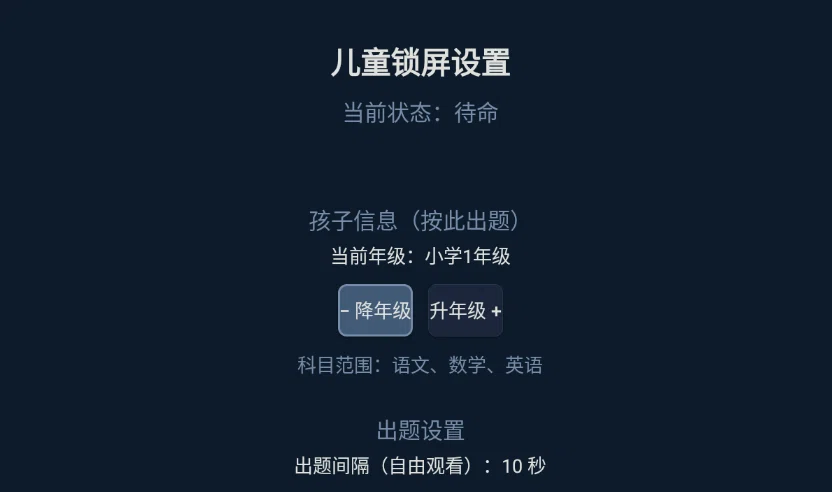

# 绿鸟儿童锁屏大师 · 电视答题锁屏（家长/孩子模式）

一款专为小米电视（Android TV / PatchWall）设计的绿鸟儿童锁屏大师应用。改造自开源 KidsLock：把原"计时→到期锁屏"升级为"**答题通关 → 自由窗口 → 到期再锁**"循环，题目按孩子的**年级 / 科目 / 学习进度**自动生成。

## 界面预览



> 设置页：当前状态、孩子信息（年级/科目）、出题间隔、解锁题数、家长 PIN、解锁问题、在线题库与操作区。
> 图为改名前版本截图（界面结构一致），其中为「10秒·测试」档，仅用于联调；正式使用请选 10 分钟以上。

## 功能

- **家长模式**：不弹题，电视正常使用；「操作」区可随时在家长/孩子模式间切换。
- **孩子模式**：
  - 开启后立即锁屏，开机也会自动弹题；
  - 每轮默认 3 题，**本轮全部答对才放行**；
  - 错题立即给出**参考答案 + 解析**，并重新抽题重做本轮；
  - 自由观看 N 分钟（默认 10）后**再次弹出题目**，循环往复；
  - 解锁题数可设为 **1 / 3 / 5 / 10** 题。
- **题目自适应**：内置 **1–9 年级共 450 题**（每级 50 题）。小学每级：语文 17、数学 17、英语 16；初中每级：语数英各 10 + 副科 20（历史/地理/生物/物理/化学/道德与法治，按年级开设）；弱项优先 + 间隔重复选题（掌握度越低 / 越久未练，越优先出现）。
- **在线题库（可选）**：填写 NAS 后台地址即可联网拉题、回传答题进度；断网或后台不可用时自动回退内置题库，离线照常可用。
- **家长 PIN**：锁屏界面输入正确 PIN 后**自动切换到家长模式**（不再弹题），默认 `1234`，建议修改。PIN 连续输错 **2 次锁定 10 分钟**（隐藏总解锁码不受影响）。
- **忘记 PIN（解锁问题）**：锁屏页 PIN 码右侧有「忘记密码？」入口，选择“母亲出生年份 / 父亲出生年份”并输入 4 位年份，**任一题答对即可切到家长模式**。设置时必须两个都填写，默认答案 `1975` / `1976`。问答**答错 2 次锁定 40 分钟**，锁定后自动返回 PIN 界面（PIN 解锁不受影响）。
- **测试辅助**：设置页有「10秒·测试」间隔档（仅用于联调锁屏链路，正式使用请选 10 分钟以上）。
- **权限引导**：打开 App 自动检查并引导开启**悬浮窗、电池省电白名单、开机自启动**三项权限（Android 10+ 必须，否则到点可能不弹题、HOME 可能绕过）。
- **防绕过**：全屏悬浮窗 + 拦截 HOME / 返回 + 前台服务守护 + 重启持久化（关机再开仍锁）。
- **家长验证保护**：孩子模式下（包括答题后的自由观看窗口）打开设置页，必须先通过家长 PIN / 解锁问题 / 隐藏码验证；答题只进入自由观看，不会暴露设置，孩子无法改 PIN 或切家长模式。
- **防卸载（可选）**：设置页可开启「设备管理器」保护，开启后卸载本应用前必须先停用设备管理器（普通 App 无法真正禁止卸载，详见“注意事项”）。

## 安装方法

### 方法一：GitHub Actions 自动出包（推荐，无需本地 Android Studio）
1. 把本仓库推送到**你自己的** GitHub 仓库（不要推到上游 wplleo/kidslock）。
2. 仓库 **Actions** 自动构建，完成后在 **Artifacts** 下载 `tv-quiz-lock-apk`，内含 `app-universal-debug.apk`。
3. 打 Release 时 APK 也会自动附在 Release 资源里。

### 方法二：adb 安装
```bash
adb connect <电视IP>:5555
adb install app-universal-debug.apk
```

### 方法三：U盘安装
将 `app-universal-debug.apk` 拷贝到 U 盘，电视「文件管理」中找到并安装（需先开启「允许安装未知来源应用」）。

## 使用流程

1. **首次打开**：电视桌面「全部应用」找到「绿鸟儿童锁屏大师」图标打开。
2. **按引导开启权限**（Android 10+ 强烈建议全部开启）：
   - 悬浮窗 / 显示在其他应用上层：到点自动弹题、HOME 拦截都依赖它；
   - 电池省电白名单：防止后台服务被系统清理；
   - 开机自启动：关机重启后自动锁屏。
3. **设置参数**：
   - 模式：在「操作」区点「开启孩子模式（立即锁屏）」或「切换到家长模式（解锁）」
   - 年级：1–9（默认 5）
   - 题目范围：按年级通用（内置题库不绑定具体教材版本）
   - 出题间隔：10 / 15 / 30 / 45 / 60 / 90 / 120 分钟，另有「10秒·测试」档
   - 题数：1 / 3 / 5 / 10（默认 3；选 1 题适合低龄孩子）
   - 家长 PIN：默认 1234，建议修改（遥控器九宫格输入）
   - 解锁问题：母亲/父亲出生年份，**必须两个都设置**；默认 1975 / 1976
   - 在线题库（可选）：点"配置服务器/孩子ID"填 NAS 后台地址（如 `http://192.168.1.10:8000`）与孩子ID，保存后自动测试连接
4. **答题解锁**：屏幕显示科目 + 题干 + 选项，遥控器方向键选择、确认提交；本轮全对方可进入电视。
5. **家长解锁**：锁屏界面输入 PIN，或点「忘记密码？」回答出生年份（任一题答对），都会自动切换到家长模式（不再弹题）。
6. **到点再锁**：自由观看时间结束后自动重新弹出题目；按 HOME 会被悬浮窗挡住并自动拉回答题页（Android 9 及以下直接重新拉起）。

## 锁屏与防绕过机制

- 全屏悬浮窗覆盖层遮挡桌面；**答题界面在前台时自动隐藏悬浮窗**，离开答题页（HOME/返回）立即重新盖上。
- 前台服务每秒检查自由观看时间，到点自动拉起答题界面；Android 10+ 后台启动被限制时由悬浮窗兜底。
- 遥控器 HOME / 返回无法绕过；锁屏状态持久化到 SharedPreferences，关机重启后由 `BootReceiver` 恢复锁屏。
- 家长 PIN 与解锁问题都只在本机保存，不上传网络。

## 项目结构

```
kidslock/
├─ .github/workflows/build.yml    # GitHub Actions 自动构建 APK
├─ docs/screenshot-settings.png   # README 界面截图
├─ app/src/main/
│  ├─ AndroidManifest.xml         # 清单（悬浮窗/开机自启/电池白名单等权限）
│  ├─ java/com/steamaple/greenbirdkidslock/
│  │  ├─ MainActivity.java        # 设置界面（模式/年级/间隔/题数/PIN/解锁问题/权限引导）
│  │  ├─ LockScreenActivity.java  # 答题卡 + PIN 键盘 + 忘记密码问答
│  │  ├─ LockService.java         # 前台服务：自由窗口计时、到点再锁、悬浮窗
│  │  ├─ BootReceiver.java        # 开机自启（孩子模式即锁）
│  │  ├─ QuestionBank.java        # 题库（离线 assets + 在线 NAS 回退）
│  │  └─ PrefManager.java         # 模式/年级/间隔/PIN/解锁问题/掌握度持久化
│  ├─ assets/questions.json       # 内置题库（1–9 年级，每级 50 题，共 450 题）
│  └─ res/layout/                 # activity_main / activity_lock_screen / overlay_lock
└─ （构建产物）app-universal-debug.apk
```

## 技术参数

- 最低支持：Android 5.0 (API 21)
- 目标版本：Android 13 (API 33)；编译版本：API 34
- 架构：armeabi-v7a / arm64-v8a（ABI splits + universalApk，universal 包覆盖所有小米电视）
- 权限：`SYSTEM_ALERT_WINDOW`（悬浮窗）、`RECEIVE_BOOT_COMPLETED`（开机自启）、`FOREGROUND_SERVICE`、`REQUEST_IGNORE_BATTERY_OPTIMIZATIONS`（省电白名单）、`INTERNET`（可选在线题库）
- 在线拉题走后台线程；未使用 API 26+ 的强制接口（通知渠道等均带版本判断），明文 HTTP 已允许（`usesCleartextTraffic`）

## 编译方法

- **自动**：推送到 GitHub 即由 Actions 用 AGP 8.2 + Gradle 8.4 + JDK 17 构建（debug 密钥签名，可 sideload）。产物为 `app-universal-debug.apk`（开启了 ABI splits + universalApk）。
- **本地**：需 JDK 17 与 Android SDK（platforms;android-34、build-tools;34.0.0）。
  ```bash
  export JAVA_HOME=<JDK17路径>
  export ANDROID_HOME=<SDK路径>
  ./gradle-dist/bin/gradle assembleDebug   # 或自备 wrapper: ./gradlew assembleDebug
  ```
- **正式签名发布**：配自有 keystore 走 `assembleRelease`，产物 `app-universal-release.apk`。

## 注意事项

- **Android 10 及以上必须开启「悬浮窗/显示在其他应用上层」权限**：打开 App 会自动弹出“开机锁屏权限”引导，一次性给出**悬浮窗、电池省电白名单、开机自启动**三个设置入口；设置页的“悬浮窗权限”状态行也可点击随时打开该引导。
- 悬浮窗未开时：自由观看时间到点可能不弹题，按 HOME 也可能绕过锁屏。
- 省电白名单：部分电视系统没有可跳转的电池优化页，可在引导里选择“打开应用详情”，手动到 `设置 → 应用 → 绿鸟儿童锁屏大师 → 电池/省电 → 允许后台运行（不限制）`。
- 开机自启动：需在电视「安全中心 → 自启动管理」允许本应用；在系统里“强行停止”过 App 会禁用开机广播，直到手动再打开一次。
- 「10秒·测试」仅用于联调：验证“答题解锁 → 到点再锁”链路，正式给孩子使用请选择 10 分钟及以上。
- 家长模式关机/重启后不会弹题；孩子模式关机会保持锁屏状态，开机由 `BootReceiver` 直接锁屏。
- **关于“孩子卸载 App”**：普通三方应用无法阻止卸载。设置页的「防卸载保护（设备管理器）」只能提高门槛（孩子需先进系统设置停用设备管理器）；更彻底的做法是：① 用小米电视自带的儿童模式/应用锁把「设置」应用锁住；② 或把本应用配置成 Device Owner（需恢复出厂、无账户，然后 `adb shell dpm set-device-owner com.steamaple.greenbirdkidslock/.KidsLockDeviceAdminReceiver`），此时 App 会调用 `setUninstallBlocked` 真正禁止卸载，并可进入 kiosk 模式。
- 内置题库覆盖 1–9 年级（每级 50 题，数学题由脚本计算生成、答案经过程序校验）；扩充题库见上层 `tv-quiz-lock/` 文档（后台 `/ui` 或批量 JSON 导入）。
- 题库答案经人工核对；若接入 LLM 生成变式，须保证参考答案正确。

## 常见问题

| 问题 | 处理 |
|---|---|
| 到点不弹答题界面 | 开启悬浮窗权限 + 省电白名单；查看设置页权限状态 |
| 按 HOME 能回到桌面 | 同上，悬浮窗未开时 Android 10+ 无法拦截 |
| 重启后不锁屏 | 检查是否家长模式、是否允许开机自启动、是否被“强行停止” |
| 忘记 PIN | 锁屏点「忘记密码？」，回答父母出生年份（任一答对即可）；答错 2 次锁 40 分钟，可返回 PIN 界面 |
| 孩子模式下能打开设置改 PIN 吗 | 不能：打开设置会先进入家长验证，验证通过切家长模式后才显示设置 |
| 题目与孩子年级不符 | 设置页调整年级；内置题库按年级通用，不绑定教材版本 |
| 在线题库连不上 | 检查 NAS 地址/后台服务；失败会自动回退内置题库 |

## 版权与内容来源

- **古代诗文**：均为公有领域作品（作者逝世已超过 50 年），仅引用名句用于答题。
- **数学题**：由脚本按年级知识点计算生成，算式、公式与事实本身不受著作权保护。
- **语文 / 英语 / 副科题**：题目与解析为原创编写，未摘录任何教材、教辅或考试真题的成段原文；单词、短句、历史/地理/科学事实属于通用表达或事实性内容。
- **教材版本**：题库按年级与学科组织，**不绑定、也不代表**任何出版社的教材版本（已移除“人教版/PEP”等标识）。
- **在线题库**：若通过 NAS 后台导入自有题目，请确保拥有相应授权。
- **上游代码**：本项目改造自开源 KidsLock，公开分发前请核对上游仓库的 LICENSE 并保留相应版权声明。
- 以上为工程侧的合规整理，不构成法律意见；如需商业发行或上架应用商店，建议对题库再做一次查重并请法务确认。
